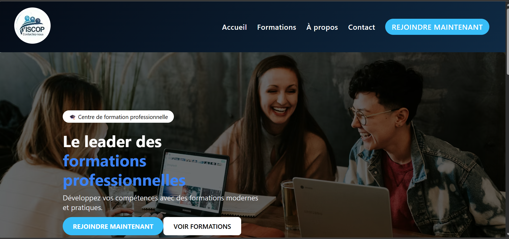
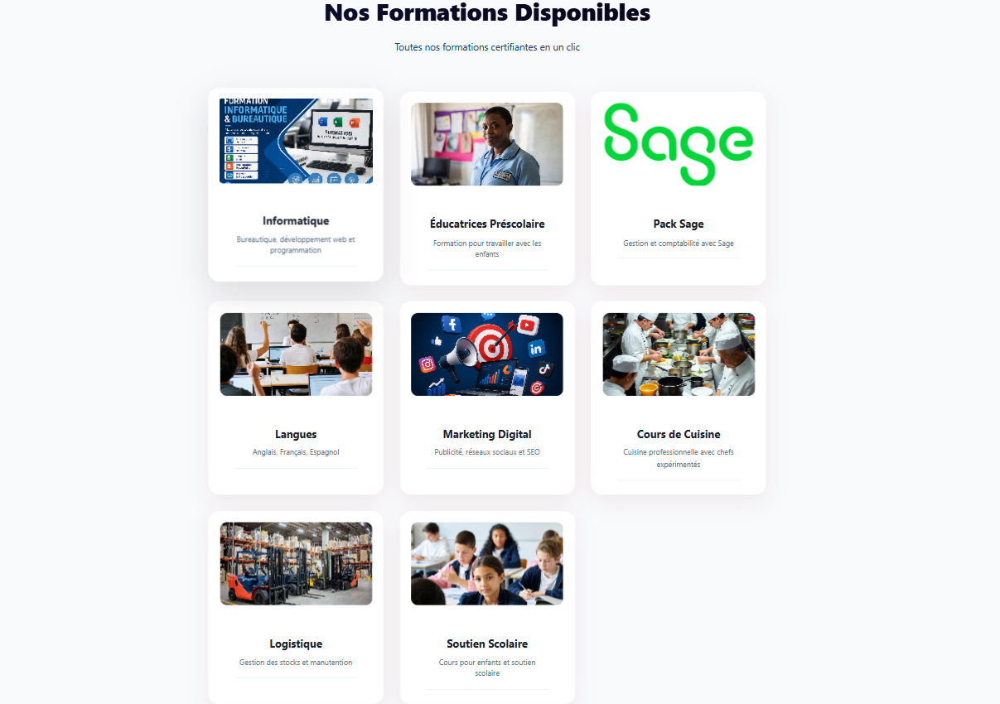
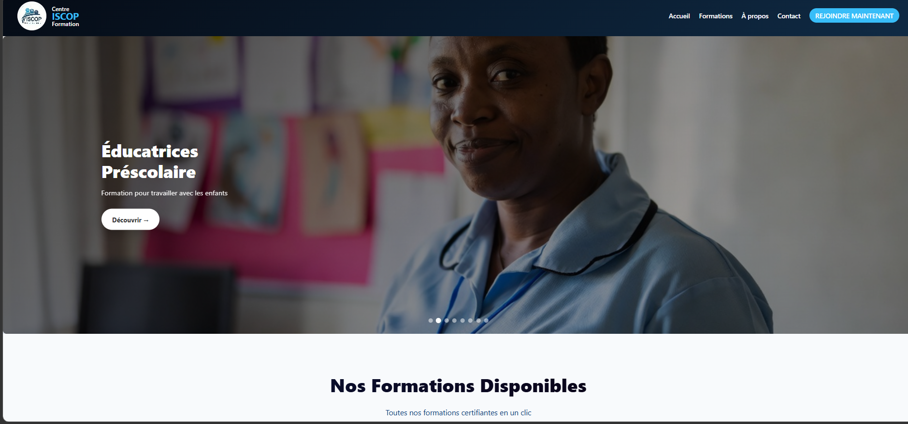
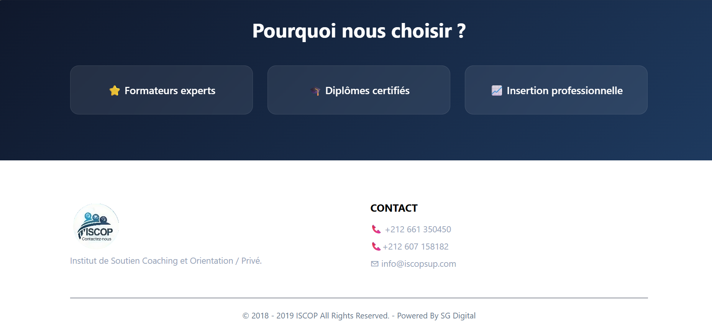
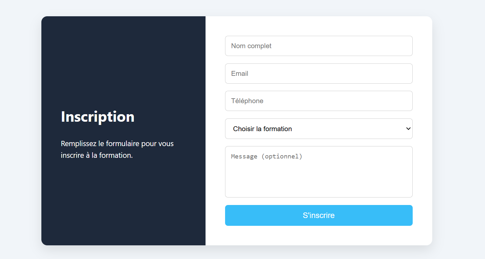
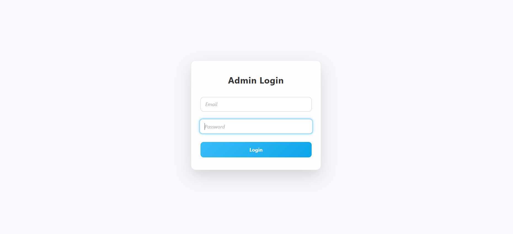
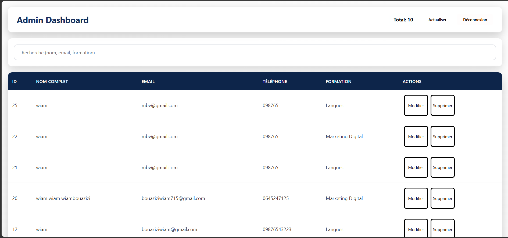

# Stage-ISCOP – Site Web Institutionnel

## Présentation du projet

Stage-ISCOP est un projet réalisé dans le cadre de mon stage au sein d'un centre situé à Meknès.

L'objectif était de concevoir et développer un site web moderne pour présenter le centre, ses formations et ses différentes activités, tout en proposant un espace d'administration.

## Technologies utilisées

- **Frontend :** React.js, CSS
- **Backend :** Laravel, PHP
- **Base de données :** MySQL

## Fonctionnalités

- **Accueil :** Présentation générale du site.
- **Présentation du centre :** Informations sur le centre.
- **Formations :** Présentation des formations proposées.
- **Galerie :** Affichage des photos du centre.
- **Contact :** Informations et formulaire de contact.
- **Espace Admin :** Interface d'administration du site.

## Structure du projet

- `frontend/` : Application React.
- `backend/` : Application Laravel.
## Captures d'écran

### Page d'accueil

### Page des formations

### Contact

### Inscription

### Espace Admin

## Objectif

Développer un site web professionnel, responsive et facile à utiliser, permettant au centre de présenter ses services et ses formations sur Internet.

## Type de projet

Projet réalisé dans le cadre d'un stage professionnel.
